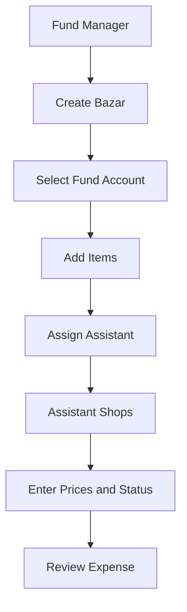
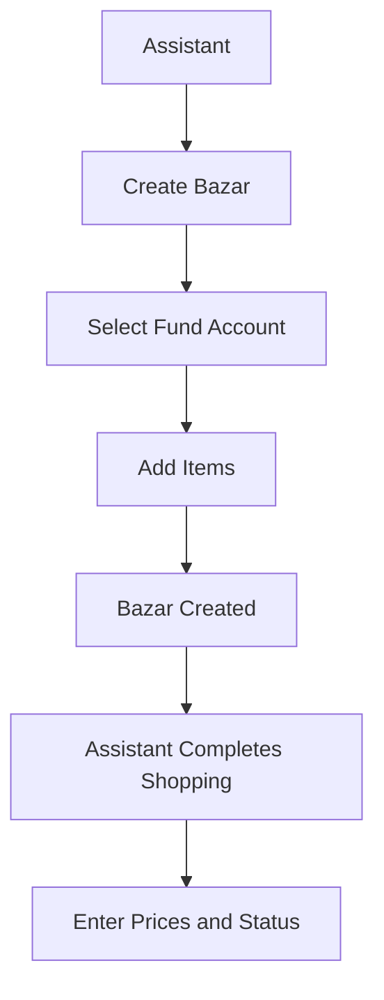

# সহজ বাজার খাতা — BazarTrack

BazarTrack is an API-first Flutter app for collaborative office market management: bazar lists, fund-account balances, assistant advances, bazar item expenses, and reports. The PHP API is the production source of truth. Drift-backed local storage and the sync queue remain compatibility/demo infrastructure while the API migration is completed; they are not a production offline guarantee. The UI is Bangla-first with common English/Banglish product terms where they are more natural for daily users.

## Key Features

- Role-based demo login for **Admin**, **Fund Manager**, and **Assistant** verification.
- Real dashboard with fund-account summary, recent bazars, sync status, and quick actions.
- Create bazars manually or from pasted text lists.
- Add bazar items from frequent items, manual entry, or parsed text.
- Fund-account balance and assistant ledger tracking.
- Fund money given entries, two-step returned-money confirmation plan, and bazar item expenses.
- Reports, with monthly-close UI retained for local/demo verification; API mode does not expose monthly close yet.
- Admin panel for user/fund-account management.
- API-backed production data flow, with Drift/SQLite compatibility storage and sync diagnostics retained during migration.
- GoRouter navigation with bottom tabs, inner page back navigation, and root exit confirmation.

## Tech Stack

- **Language**: Dart `^3.11.1`
- **Framework**: Flutter
- **State management**: Riverpod
- **Routing**: GoRouter
- **Production data source**: PHP JSON API via Dio
- **Compatibility local database**: Drift + SQLite for demo data and the existing migration-era sync queue
- **Connectivity**: connectivity status and queue diagnostics; full production offline synchronization is not currently promised
- **Notifications**: in-app mock notification center; push notifications are not configured and are outside the current production scope
- **Testing**: Flutter tests, provider tests, widget tests

## Prerequisites

- Flutter SDK with Dart compatible with `sdk: ^3.11.1`
- Android SDK for APK builds

## Getting Started

Start and seed the local development API:

```bash
php -S 127.0.0.1:8080 -t api
```

The supported setup and acceptance path is the local harness. It starts an isolated PHP server, sends the required setup requests with `POST`, seeds deterministic demo data, runs API/Flutter contract checks, and stops the server:

```powershell
pwsh -File scripts/test-local-api.ps1
```

Setup routes reject `GET` and are available only when the server runs with `APP_ENV=development` and `DEMO_MODE=true`.

Then run Flutter:

```bash
flutter pub get
dart run build_runner build --delete-conflicting-outputs
flutter run
```

The checked-in `assets/env/app.env` is development-only. Android emulators cannot reach the host through `127.0.0.1`; override the base URL with `--dart-define=BAZAR_API_BASE_URL=http://10.0.2.2:8080/index.php`. Physical devices require the host LAN address.

Production builds must set `BAZAR_APP_ENV=production`, enable the API, use a non-local HTTPS URL, and replace every demo default ID. `ApiConfig` fails fast when those rules are violated.

Build a debug APK:

```bash
flutter build apk --debug
```

APK output:

```text
build/app/outputs/flutter-apk/app-debug.apk
```

## Demo Role Login

Development builds expose temporary demo buttons so QA can verify role-specific behavior against deterministic demo data. Release builds must disable them, and the production API denies setup/demo seed routes.

| Button | Mock user | Role | Main purpose |
| --- | --- | --- | --- |
| `Login as Admin` | Admin User | Admin | Verify admin panel, all fund accounts/bazars, reports, local/demo monthly-close UI, money entry |
| `Login as Fund Manager` | Mr. CEO | Fund Manager (`owner` role key) | Verify managed fund accounts, reports, money entry |
| `Login as Assistant` | Rahim Uddin | Assistant | Verify shopping/bazar flow and restricted reports/admin/money-entry access |

The demo buttons are controlled by a compile-time flag in `login_screen.dart`:

```dart
const kEnableDemoRoleLogin = bool.fromEnvironment(
  'BAZAR_ENABLE_DEMO_ROLE_LOGIN',
  defaultValue: true,
);
```

Disable them for any production-like build:

```bash
flutter build apk --release \
  --dart-define=BAZAR_APP_ENV=production \
  --dart-define=BAZAR_ENABLE_DEMO_ROLE_LOGIN=false \
  --dart-define=BAZAR_API_BASE_URL=https://api.example.com/index.php \
  --dart-define=BAZAR_DEFAULT_FUND_ID=<production-id> \
  --dart-define=BAZAR_DEFAULT_ACCOUNT_ID=<production-id> \
  --dart-define=BAZAR_DEFAULT_MANAGER_ID=<production-id> \
  --dart-define=BAZAR_DEFAULT_ASSISTANT_ID=<production-id>
```

The release configuration intentionally fails before startup if it resolves to localhost, HTTP, a disabled API, or demo IDs.

## Role-Based App Flows

### Admin

Use **Login as Admin**.

Admin is for full-access verification and setup work.

Capabilities:

- Create users
- Create fund accounts
- Create Bazar
- Assign assistants
- View all reports
- Manage closing flows

Suggested verification path:

1. Tap **Login as Admin**.
2. Confirm Home shows `Admin User — অ্যাডমিন`.
3. Verify Reports tab is visible.
4. Verify **টাকা এন্ট্রি** is visible.
5. Go to **More** and verify **অ্যাডমিন প্যানেল** is visible.
6. Open Admin panel and verify add user/add fund account entry points.
7. Go to Balance and verify all fund accounts are visible.
8. Go to Bazar list and verify all bazars are visible.
9. Create a bazar, optionally assign an assistant, and add items.

### Fund Manager

Use **Login as Fund Manager**.

Fund Manager is for account-dept/fund-owner money and reporting verification. The underlying demo role key is still `owner` for compatibility.

Capabilities:

- View managed fund accounts
- Create Bazar
- Assign Assistant
- Enter fund money
- Review reports
- Review assistant balances

Expected hidden/restricted actions:

- Admin panel hidden

Suggested verification path:

1. Tap **Login as Fund Manager**.
2. Confirm Home shows `Mr. CEO — হিসাব ম্যানেজার`.
3. Confirm Reports tab is visible.
4. Tap **টাকা এন্ট্রি** to verify fund-manager/admin money entry access.
5. Go to **Reports** and verify monthly summary/report UI.
6. Go to **More** and verify:
   - Reports visible
   - Close হিসাব not visible
   - Admin panel not visible
7. Go to **Balance** and verify manager-scoped fund accounts only.
8. Create a bazar from **নতুন বাজার** and assign an assistant if needed.

### Assistant

Use **Login as Assistant**.

Assistant is the best role for verifying day-to-day shopping work.

Capabilities:

- View assigned/unassigned bazars
- Execute shopping
- Update purchased status
- Enter actual prices
- Mark unavailable items
- Add notes
- Add additional items

Assistant can currently create a Bazar list from **নতুন বাজার** on behalf of the selected fund account/owner if they have access to that screen.

However:

- Assistant cannot assign another assistant.
- Assistant-created bazars keep `assignedTo` empty and are not assigned to another user.

Expected hidden/restricted actions:

- Reports tab hidden
- Money entry hidden
- Admin panel hidden
- Monthly close hidden from More menu

#### Assistant: Create a Bazar and Add Items

1. Tap **Login as Assistant**.
2. From Home, tap **নতুন বাজার**.
3. On **নতুন বাজার** screen:
   - Select a **Fund account** when more than one is visible.
   - Choose input mode:
     - **Manual**: type item name and optionally quantity/unit/brand.
     - **Text**: paste one item per line, e.g.
       ```text
       আলু ২ কেজি
       ডিম ১২টা
       দুধ ২ প্যাকেট
       ```
   - Optional: edit title/note.
4. Tap **বাজার তৈরি করুন →**.
5. The app opens the bazar detail page. The created bazar is linked to the selected fund account/owner and remains unassigned.
6. Tap **আইটেম যোগ**.
7. On **আইটেম যোগ করুন**:
   - Tap a frequent item, or
   - Type **আইটেম নাম**.
   - Optional: expand quantity/unit/brand/note.
8. Tap:
   - **+ আরেকটি** to add and stay on the item screen.
   - **✓ শেষ করুন** to add and return to bazar detail.
9. Back on bazar detail, tap an item to edit status/price through the item edit sheet.
10. Tap **আজকের বাজার শেষ** when the shopping is complete.

Relevant screens:

- `lib/features/bazar/presentation/screens/new_bazar_screen.dart`
- `lib/features/bazar/presentation/screens/bazar_detail_screen.dart`
- `lib/features/bazar/presentation/screens/add_item_screen.dart`

## Practical Role Playbooks

These are end-to-end ways to use the app with the current demo roles. They are written as real QA/user stories, not just permission checks.

### Admin or Fund Manager Places a Bazar List for an Assistant

Use this when an admin or fund manager/account-dept user wants to prepare a shopping list and let an assistant complete the market work.

Current supported app behavior:

- Admin can create a bazar and assign an assistant.
- Fund Manager can create a bazar under a managed fund account and assign an assistant.
- Assistant can see bazars where `assignedTo == null` or `assignedTo == assistant.id`.
- If no assistant is selected, the bazar stays unassigned/team-visible for assistants.

Steps:

1. Login with **Login as Fund Manager**.
2. Tap **নতুন বাজার** from Home.
3. Select the fund account, for example `Office Lunch Bazar`, if more than one fund account is visible.
4. Under **Assign assistant**, pick an active assistant such as `Rahim Uddin`, or leave it as unassigned if any assistant can take it.
5. Choose input mode:
   - **একে একে** for adding items one by one.
   - **টেক্সট** for pasting a ready shopping list.
6. If using text mode, paste a list like:

   ```text
   আলু ২ কেজি
   পেঁয়াজ ১ কেজি
   ডিম ১২টা
   দুধ ২ প্যাকেট
   ```

7. Keep title as `আজকের বাজার` or rename it, e.g. `Office Lunch Bazar`.
8. Tap **বাজার তৈরি করুন →**.
9. Logout from More.
10. Login with **Login as Assistant**.
11. Open **বাজার** tab.
12. Find the bazar assigned to that assistant, or any unassigned bazar.
13. Open it and use:
    - **আইটেম যোগ** if more items are needed.
    - item tap/edit sheet to mark items done/not found and enter price.
14. Tap **আজকের বাজার শেষ** when shopping is done.
15. Logout and login as Fund Manager again.
16. Fund Manager checks **Balance** and **Reports** to review spend and remaining balance.

This flow is the direct fund-manager-to-assistant handoff path in the app.

### Fund Manager Gives Money to Assistant Before Shopping

Use this when a fund manager/account-dept user advances cash to an assistant.

1. Login with **Login as Fund Manager**.
2. Tap **টাকা এন্ট্রি** from Home.
3. Select fund account/assistant fields shown on the money entry screen.
4. Enter the amount given to the assistant.
5. Save the entry.
6. Go to **Balance**.
7. Open the fund account or assistant ledger to verify the assistant balance changed.
8. Assistant can then login and complete bazar shopping.

Expected restrictions:

- Assistant should not see **টাকা এন্ট্রি**.

### Assistant Completes Shopping Details

Use this after a bazar list is available to an assistant, whether it was assigned by Admin/Fund Manager, left unassigned, or created by the assistant on behalf of a selected fund account/owner.

Assistant manages execution details:

- Purchased/not purchased status
- Actual market price
- Item availability
- Notes
- Additional required items

Example:

```text
Requested:
Rice 5kg

Assistant updates:
Status: Purchased
Price: 450 BDT
Note: Brand unavailable, bought alternative
```

Steps:

1. Login with **Login as Assistant**.
2. Open **বাজার** tab.
3. Open the available unassigned/self bazar.
4. Review the item list.
5. Tap any item to update:
   - purchased/done status
   - actual market price
   - not found/unavailable status
   - notes
6. Tap **আইটেম যোগ** if an extra item needs to be added.
7. Use **+ আরেকটি** for multiple items or **✓ শেষ করুন** to return.
8. Finish the bazar with **আজকের বাজার শেষ**.
9. Check More → Sync queue if offline work is pending.

Expected restrictions:

- Reports tab hidden.
- Money entry hidden.
- Monthly close hidden.
- Admin panel hidden.
- Assign assistant hidden.

### Fund Manager Reviews Work Continuously

Use this after assistants have entered bazar item prices.

1. Login with **Login as Fund Manager**.
2. Open **Balance** to review fund-account and assistant balances.
3. Open **Reports** to review monthly spend.
4. Use **টাকা এন্ট্রি** when fund money is given to an assistant.
5. For returned money, use the backend two-step flow: assistant creates a return request, then a fund manager confirms after counting cash.
6. Keep the assistant balance active until the employee/assistant leaves or is fired.
7. Settle the assistant balance back to 0 through confirmed money entries/return confirmations instead of monthly close.

Expected restrictions:

- Fund Manager can access reports and money entry.
- Fund Manager cannot access monthly close or admin panel.

### Admin Sets Up Demo Operating Structure

Use this when verifying admin-only operations.

1. Login with **Login as Admin**.
2. Open **More**.
3. Tap **অ্যাডমিন প্যানেল**.
4. Verify user and fund-account management options.
5. Use add user/add fund account entry points if needed.
6. Return to Home.
7. Verify Admin can see:
   - Reports
   - Money entry
   - Admin panel
   - all fund accounts
   - all bazars
8. Create a bazar and add items to verify Admin can perform operational work too.

### Admin Audits Role Visibility

Use this to confirm role scoping during QA.

1. Login as Admin and note all fund accounts/bazars are visible.
2. Logout.
3. Login as Fund Manager and confirm only managed fund accounts are visible.
4. Logout.
5. Login as Assistant and confirm only unassigned/self-assigned bazars are visible.
6. Verify assistant cannot see Reports/Admin/Money Entry.

## Direct Assistant Assignment

The **নতুন বাজার** screen includes an **Assign assistant** section for Admin/Fund Manager. It lists active assistants and also supports an unassigned option.

Supported handoff flows:

```text
Admin/Fund Manager assigns bazar to Rahim → Rahim sees it → Rahim completes shopping
Admin/Fund Manager leaves bazar unassigned → assistants can see it → any assistant can take/action it
Assistant creates bazar for selected fund account/owner → bazar remains unassigned → assistant can complete shopping
```

Assistant filtering respects:

```text
assignedTo == null || assignedTo == currentAssistant.id
```

Assistant cannot assign another assistant from the current UI.

## Bazar Creation and Item Entry Details

### Create Bazar

Route:

```text
/bazars/new
```

Entry points:

- Home quick action: **নতুন বাজার**
- Bazar-related navigation after login

Important behavior:

- `/bazars/new` must be matched before `/bazars/:bazarId` so `new` is not treated as a bazar ID.
- The screen supports **Manual** and **Text** input modes.
- Manual mode supports adding multiple items before creating the bazar.
- Text mode parses one item per line.
- If the role has exactly one visible fund account, the account is auto-selected and the selector is hidden.
- If the role has multiple visible fund accounts, the fund account selector is shown.
- Admin/Fund Manager-created bazars can be assigned to an assistant.
- Assistant-created bazars are created on behalf of the selected fund account/owner and remain unassigned because the assistant assignment UI is hidden.
- Create button: **বাজার তৈরি করুন →**
- Draft button: **Draft সংরক্ষণ করুন**

### Bazar Creation Workflows

#### Workflow A: Fund Manager Creates Bazar



Admin follows the same creation and assistant-assignment pattern, with all fund accounts visible.

#### Workflow B: Assistant Creates Bazar



This workflow exists in the current implementation. The bazar is created on behalf of the selected fund account/owner, while the acting assistant remains the item/activity actor. Future business rules may restrict it or convert it into a request/approval workflow.

### Developer Notes

The UI permission currently controls assistant assignment, not Bazar creation.

Implementation behavior:

```dart
canAssignAssistant = owner || admin
```

Bazar creation itself is available through the same **নতুন বাজার** screen.

When creating:

```dart
assignedTo: canAssignAssistant ? selectedAssistant : null
```

Therefore:

- Admin/Fund Manager-created bazar can be assigned.
- Assistant-created bazar remains unassigned.
- For assistant-created bazars, `createdBy` stores the selected fund account owner/on-behalf-of user, while `actorId` stores the real acting assistant for initial item and activity attribution.

Tracking handoff notes:

- Monthly close events should allow `admin` only as actor role; fund-manager monthly-close entry/impression/click/submit events are unexpected.
- Bazar creation analytics should include the resolved `fund_account_id` and `fund_account_selection_method` with values `auto_single_account` or `manual_selector`.
- Analytics should store `actor_product_role = fund_manager` separately from compatibility `actor_role_key = owner`.
- Returned-money analytics should use return-request lifecycle events, not normal money-entry create events, and balance/report totals should update only after `return_request_confirmed` / `assistant_return_confirmed`.
- Return-request tracking should include confirmation status, permission result, sync state, idempotency/client operation id, and `ledger_entry_id` only after confirmation.

### Add Items After Bazar Creation

From bazar detail:

- Action button: **আইটেম যোগ**
- Opens: **আইটেম যোগ করুন**
- Supports:
  - Frequent item chips
  - Manual item name
  - Optional quantity/unit/brand/note
  - **+ আরেকটি** to keep adding
  - **✓ শেষ করুন** to finish and return

### Edit Existing Items

On bazar detail, tapping an item opens the item edit sheet unless the bazar is closed.

Use this to verify:

- purchased/done status
- not found status
- price entry
- notes/status changes

## Role Permissions Summary

| Action | Admin | Fund Manager | Assistant |
| --- | --- | --- | --- |
| Create Bazar | Yes | Yes | Yes |
| Assign Assistant | Yes | Yes | No |
| Add Items | Yes | Yes | Yes |
| Update Price | Yes | Yes | Yes |
| Update Availability | Yes | Yes | Yes |
| View Reports | Yes | Yes | No |
| Money Entry | Yes | Yes | No |
| Admin Panel | Yes | No | No |

Additional visibility notes:

| Area | Admin | Fund Manager | Assistant |
| --- | --- | --- | --- |
| Fund account visibility | All fund accounts | Managed fund accounts | Linked fund accounts |
| Bazar visibility | All bazars | Bazars in managed fund accounts | Unassigned or assigned to self |
| Returned-money confirmation | Yes | Confirm for managed fund | Request only |
| Monthly close | Local/demo only; API unsupported | No | No |

## Architecture

Feature-first clean architecture:

```text
lib/
  core/
    database/     Drift schema and generated database
    mock/         Seed data for local/demo runs
    router/       GoRouter routes, shell, redirects, role guards
    sync/         Offline sync queue and sync engine
    theme/        App colors, text styles, Material theme
    utils/        Currency/date/balance helpers
  features/
    admin/
    auth/
    bazar/
    comments/
    money/
    notifications/
    reports/
    search/
    settings/
    wallet/       current local feature name for fund-account balance/ledger
  shared/
    models/
    providers/
    widgets/
```

Layering rule:

```text
presentation -> domain <- data
```

Presentation should use providers/repositories rather than directly reaching across into data implementation details.

## API-First Runtime

- The PHP API is the production source of truth for identity, authorization, bazars, accounts, ledger entries, and reports.
- Flutter API repositories call the backend through Dio and refresh affected Riverpod state after mutations.
- Drift, seeded mock datasources, and `sync_queue_items` remain compatibility/demo infrastructure during the migration. API mode does not currently provide complete offline operation.
- Connectivity and queue screens are diagnostic surfaces, not a promise that every API action can be completed offline.
- `owner` remains the compatibility role key, while the product label is **Fund Manager** / **হিসাব ম্যানেজার**.
- Returned money uses two operations: an assistant creates a request, then an authorized manager confirms it before ledger or balance changes.

PHP API:

- Source folder: `api/`
- Router style: `api/index.php?cmd=<controller>&action=<method>&other=params`
- Development database: SQLite at `api/storage/dev.sqlite`
- ORM: bundled php-activerecord at `api/vendor/php-activerecord/`
- Production database target: MySQL via `api/config.php` or environment variables
- `setup/seed` and `setup/seedDemo` are development-only operations controlled by server environment policy.
- Local setup notes: `api/README.md`

## Important Routes

```text
/login
/
/bazars
/bazars/new
/bazars/:bazarId
/bazars/:bazarId/items/add
/bazars/:bazarId/summary
/bazars/:bazarId/comments
/bazars/:bazarId/price-history
/balance
/wallets/:walletId
/wallets/:walletId/assistant/:assistantId
/money/entry
/reports
/reports/monthly-close
/admin
/admin/users/add
/admin/wallets/add
/notifications
/search
/more
/settings
/sync/offline-queue
/profile/edit
```

## Testing and Validation

Run static analysis:

```bash
flutter analyze
```

Run all tests:

```bash
flutter test
```

Run role-focused tests:

```bash
flutter test test/widget_test.dart
flutter test test/features/auth/data/repositories/auth_repository_impl_test.dart
flutter test test/features/settings/settings_screens_test.dart
flutter test test/features/wallet/presentation/providers/wallet_providers_test.dart
flutter test test/features/bazar/presentation/providers/bazar_providers_test.dart
```

Build debug APK:

```bash
flutter build apk --debug
```

Validation commands must be rerun after each production-readiness workstream; do not treat historical results as current evidence.

## Known Non-Production Gaps

The app is suitable for local APK/demo verification, but not production-final yet.

Known gaps:

- Development retains deterministic demo credentials and local compatibility storage.
- API-mode feature coverage and provider refresh behavior must pass the integration acceptance suite before release.
- Push notifications are not configured; the current notification center uses in-app mock data.
- Some business actions still require final API contracts or must be hidden before release.
- Full manual APK QA must be repeated for each role before release.

## Recommended Manual QA Checklist

For each role:

1. Fresh install or logout.
2. Login with the matching demo button.
3. Confirm role label in Home and More.
4. Verify visible tabs/actions match the permission table.
5. Create a bazar.
6. Add items using frequent item, manual item, and text list where applicable.
7. Open bazar detail and edit item status/price.
8. Verify Balance visibility for the role.
9. Verify More menu restrictions.
10. Restart app and confirm the selected role/session restores correctly.

Admin-specific:

- Verify Add User/Add Fund Account entry points.
- Verify all fund accounts/bazars are visible.

Fund Manager-specific:

- Verify reports and money entry.
- Verify admin restrictions.
- Verify returned-money confirmation is not treated as direct assistant balance mutation.

Assistant-specific:

- Verify reports/monthly close/admin are hidden.
- Verify bazar visibility is unassigned/self-assigned only.
